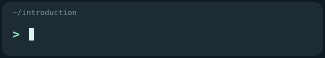
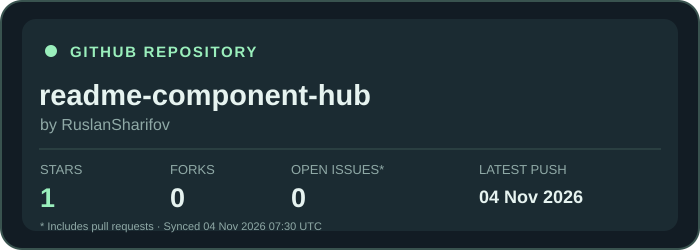
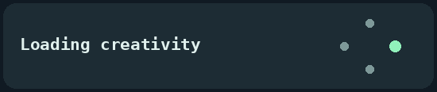
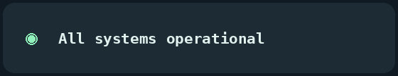
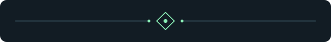
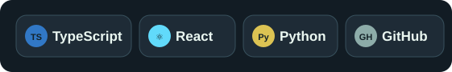
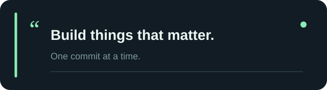
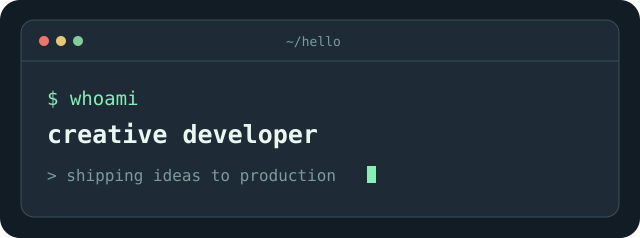

<div align="center">

# README Component Hub

### Make your README remarkable.

A community-built collection of beautiful **GitHub README components**, including animated GIFs, SVG cards, badges, and dividers.

**Preview it. Customize it. Copy the Markdown.**

[**Explore the live gallery**](https://ruslansharifov.github.io/readme-component-hub/) · [Contribute a component](CONTRIBUTING.md) · [Browse the source](components/)

[](https://github.com/RuslanSharifov/readme-component-hub/actions/workflows/validate.yml)
[](https://github.com/RuslanSharifov/readme-component-hub/actions/workflows/deploy.yml)
[](LICENSE)



</div>

---

## ✨ What is README Component Hub?

README Component Hub helps developers make their GitHub profiles and project documentation more expressive without setting up a backend or writing their own animations.

- **Real previews:** the gallery displays the actual SVG or GIF assets used in a README.
- **Ready-to-paste Markdown:** choose a component and copy its embed code.
- **Dark and light themes:** every component includes both variants.
- **Search and filters:** discover components by title, category, tag, or author.
- **Community contributions:** anyone can propose new components through a pull request.
- **GitHub-powered:** source, images, validation, and hosting all live on GitHub.

> [!TIP]
> Open the **[live gallery](https://ruslansharifov.github.io/readme-component-hub/)** to preview the animations, change themes and alignment, and copy the exact Markdown snippet.

## 📊 Dynamic GitHub repository card

The **Repository Stats Card** retrieves public data through GitHub Actions and publishes a standalone SVG image. It includes **stars, forks, open issues (GitHub's count also includes pull requests), latest push date and refresh time**.

<div align="center">
  
</div>

```md

```

The card is updated by a **scheduled GitHub Action approximately once per hour** (GitHub may delay scheduled jobs). It does not refresh instantly when the number of stars changes. To track a different repository, create a new component manifest with `"renderer": "github-repo"` and `"repository": "OWNER/REPO"`, and open a PR. See [CONTRIBUTING.md](CONTRIBUTING.md).

## 🎬 Animated components

These are real, looping GIF files stored in this repository. The previews below are also usable in your own `README.md`.

| Typing Introduction | Orbit Loader |
|:---:|:---:|
|  |  |
| An animated terminal-style greeting. [Source](components/typing-intro/) · [Light](generated/typing-intro/light.gif) | Smooth orbiting dots. [Source](components/orbit-loader/) · [Light](generated/orbit-loader/light.gif) |

| Neon Waveform | System Status |
|:---:|:---:|
|  |  |
| A music-inspired waveform. [Source](components/neon-wave/) · [Light](generated/neon-wave/light.gif) | A pulsing operational status badge. [Source](components/pulse-status/) · [Light](generated/pulse-status/light.gif) |

## 🧩 SVG components

Lightweight, static SVG designs that work in GitHub README files.

| Minimal Divider | Tech Stack Pills |
|:---:|:---:|
|  |  |
| Separate README sections elegantly. [Source](components/minimal-divider/) · [Light](components/minimal-divider/light.svg) | Show a compact tech stack. [Source](components/tech-pills/) · [Light](components/tech-pills/light.svg) |

| Developer Quote | Terminal Card |
|:---:|:---:|
|  |  |
| A simple inspirational quote card. [Source](components/code-quote/) · [Light](components/code-quote/light.svg) | A developer-themed terminal panel. [Source](components/terminal-card/) · [Light](components/terminal-card/light.svg) |

## 🚀 Use a component in your README

**1.** Visit the [component gallery](https://ruslansharifov.github.io/readme-component-hub/).

**2.** Choose a component, then select **Dark / Light** and **Left / Center** alignment.

**3.** Click **Copy Markdown** and paste the result into any GitHub `README.md`.

For example, to display the animated **Neon Waveform**:

```md

```

For a centered component:

```html
<p align="center">
  
</p>
```

For the light theme, replace `dark.gif` with `light.gif`. SVG components use `dark.svg` and `light.svg` instead.

> [!IMPORTANT]
> **Use the `raw.githubusercontent.com` links generated by the gallery** in your README. The website runs on GitHub Pages, but the README-ready image files are stored directly in this repository.

## 🤝 Add your own component

This is an **open-source community gallery**. You can submit an original SVG or GIF component without installing a separate app or registering a new account beyond GitHub.

1. **Fork** this repository and create a branch.
2. Add a new directory under `components/your-component-name/`.
3. Include a `component.json` manifest, a `README.md`, and your component images (dark and light).
4. Follow the safety and file naming rules in [CONTRIBUTING.md](CONTRIBUTING.md).
5. Open a **pull request**. After review and merge, GitHub Actions rebuilds the gallery.

The component metadata looks like this:

```json
{
  "id": "minimal-divider",
  "title": "Minimal Divider",
  "description": "A precise, understated line to separate your README sections.",
  "category": "Dividers",
  "tags": ["line", "divider", "minimal"],
  "author": "RuslanSharifov",
  "format": "svg",
  "featured": true,
  "order": 5,
  "addedAt": "2026-11-03",
  "themes": {
    "dark": "components/minimal-divider/dark.svg",
    "light": "components/minimal-divider/light.svg"
  }
}
```

For animated GIF submissions, refer to [the contribution guide](CONTRIBUTING.md). The gallery accepts files and metadata through GitHub pull requests; it does **not** execute arbitrary scripts from contributors.

## 🛠️ How it works

| Part | Technology |
|---|---|
| Website | HTML, CSS, and vanilla JavaScript |
| Hosting | GitHub Pages |
| Component catalog | Per-component JSON manifests |
| Artwork | SVG + animated GIF + periodically updated repository stats SVG |
| Automated builds and checks | GitHub Actions |
| Community contributions | GitHub pull requests |
| Database / separate backend | Not required |

Dynamic GitHub stats cards are refreshed hourly by a scheduled workflow. The catalog is generated by `scripts/build_catalog.py`. The built-in animated examples are rendered by `scripts/render_gifs.py` and committed to `generated/` by the deployment workflow. Both themes are served as normal files, and the website uses the same images for its live previews.

### Run locally

Requirements: Python 3.10+ and Pillow for GIF rendering.

```bash
git clone https://github.com/RuslanSharifov/readme-component-hub.git
cd readme-component-hub
python3 -m pip install -r requirements-assets.txt
python3 scripts/build_catalog.py
python3 scripts/render_gifs.py
python3 -m http.server 8000
```

Open [http://localhost:8000](http://localhost:8000) in your browser. A separate JavaScript build tool is not needed.

### Deploy with GitHub Pages

Under **Settings → Pages → Build and deployment**, select **GitHub Actions**. The [deployment workflow](.github/workflows/deploy.yml) publishes the site whenever changes are pushed to `main`.

**Live website:** https://ruslansharifov.github.io/readme-component-hub/

---

<div align="center">

### Made for the GitHub developer community.

**[Explore components](https://ruslansharifov.github.io/readme-component-hub/)** · **[Contribute](CONTRIBUTING.md)** · **[Report an issue](https://github.com/RuslanSharifov/readme-component-hub/issues)**

Maintained by [@RuslanSharifov](https://github.com/RuslanSharifov) · Licensed under [MIT](LICENSE)


</div>
