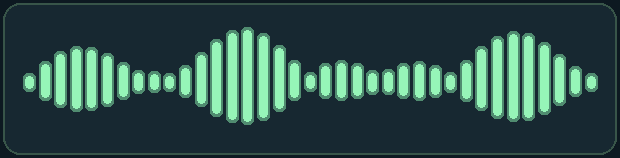

<div align="center">

# README Component Hub

**An interactive, aurora-neon README experience.**

[**Open the Gallery**](https://ruslansharifov.github.io/readme-component-hub/) · [**README Designer**](https://ruslansharifov.github.io/readme-component-hub/designer.html) · [Contribute](CONTRIBUTING.md)

[](https://github.com/RuslanSharifov/readme-component-hub/actions/workflows/validate.yml)
[](https://github.com/RuslanSharifov/readme-component-hub/actions/workflows/deploy.yml)

</div>

## Available component: Neon Waveform

Neon Waveform is currently the **only published component**. More designs will be added after the editor experience is complete.

<p align="center">
  <strong>the rhythm of building</strong><br />
  
</p>

### Use it in your README

Open the [README Designer](https://ruslansharifov.github.io/readme-component-hub/designer.html), click **Add to README**, edit the caption, choose a theme, width and alignment. The GitHub-style preview updates as you type. Copy the Markdown or download the entire README file.

Example output:

```html
<p align="center">
  <strong>Your custom title</strong><br />
  
</p>
```

**Important:** GitHub README cannot put arbitrary editable text *inside* a remotely hosted animated GIF. The Designer therefore places the caption immediately above the GIF within the same HTML paragraph. What you preview is what the copied Markdown will render. The GIF remains animated, and you do not need a backend.

### Aurora Neon site theme

The site uses deep navy and violet surfaces, mint/cyan lighting, rounded glass panels and pointer-driven glow. The 3D hero draws **3–5×** the previous particle density (depending on frame rate) and adapts between **1,530–2,550** points on phones, **2,940–4,900** on tablets and **5,100–8,500** on desktops. Clicking the hero moves to the next 3D shape; the renderer no longer forces shape changes on a fixed interval. Motion respects `prefers-reduced-motion` and stops when off-screen.

## Local development

Requires Python 3.10+, Pillow and Node.js for tests.

```bash
python -m pip install -r requirements-assets.txt
python scripts/build_catalog.py
python scripts/render_gifs.py
node --test tests/*.test.mjs
python -m http.server 8000
```

Open http://localhost:8000/. GitHub Actions validates the component, generates dark and light GIFs, and deploys the static site to GitHub Pages.

## Contributing

New components are accepted through reviewed pull requests. See [CONTRIBUTING.md](CONTRIBUTING.md).

MIT licensed.
