<div align="center">

# README Component Hub

### Make your README remarkable.

A community-built library of **GitHub README components**: animated GIFs, live SVG cards, badges and dividers, ready to paste into any `README.md`.

**Preview it · Customise it · Copy the Markdown**

[**Live gallery**](https://ruslansharifov.github.io/readme-component-hub/) · [**README Designer**](https://ruslansharifov.github.io/readme-component-hub/designer.html) · [Contribute](CONTRIBUTING.md) · [Browse components](components/)

[](https://github.com/RuslanSharifov/readme-component-hub/actions/workflows/validate.yml)
[](https://github.com/RuslanSharifov/readme-component-hub/actions/workflows/deploy.yml)
[](LICENSE)
[](https://github.com/RuslanSharifov/readme-component-hub/stargazers)

<br />


</div>

---

## Table of contents

- [Why README Component Hub?](#why-readme-component-hub)
- [Quick start](#quick-start)
- [Component gallery](#component-gallery)
- [Dynamic GitHub cards](#dynamic-github-cards)
- [README Designer](#readme-designer)
- [Add your own component](#add-your-own-component)
- [How it works](#how-it-works)
- [Run and deploy locally](#run-and-deploy-locally)
- [License](#license)

---

## Why README Component Hub?

Expressive READMEs usually require custom animation code or a server. This project removes both. Every component is a static SVG or GIF hosted on GitHub, so it works on any profile or repository without a backend.

| | Feature |
|---|---|
| 🔍 | **Real previews**: the gallery shows the exact assets your README will load. |
| 🎨 | **Three themes**: every component ships in dark and light, and most include neon. |
| 📋 | **One-click Markdown**: copy an embed snippet with width and alignment already set. |
| 📊 | **Dynamic cards**: repository stats, CI status, release info and star history refresh hourly. |
| 🧱 | **Visual designer**: compose text, components and multi-column rows, then export `README.md`. |
| 🤝 | **Community-driven**: contribute components through a standard GitHub pull request. |

> [!TIP]
> Open the **[live gallery](https://ruslansharifov.github.io/readme-component-hub/)** to preview animations, switch themes and alignment, and copy the exact Markdown.

---

## Quick start

1. Visit the [component gallery](https://ruslansharifov.github.io/readme-component-hub/) and choose a component.
2. Select a theme (dark, light or neon) and an alignment.
3. Click **Copy Markdown** and paste it into your `README.md`.

For example, to display the animated **Neon Waveform**:

```md

```

To centre the component:

```html
<p align="center">
  
</p>
```

For the light theme, replace `dark.gif` with `light.gif`. SVG components use `dark.svg` and `light.svg`.

> [!IMPORTANT]
> Use the `raw.githubusercontent.com` links generated by the gallery. The website runs on GitHub Pages, but the image files are stored directly in this repository.

---

## Component gallery

### 🎬 Animated components

Looping GIF files stored in this repository. Each one can be used directly in your own README.

| Typing Introduction | Orbit Loader |
|:---:|:---:|
|  |  |
| An animated terminal-style greeting. · [Source](components/typing-intro/) · [Light](generated/typing-intro/light.gif) | Smooth orbiting dots. · [Source](components/orbit-loader/) · [Light](generated/orbit-loader/light.gif) |

| Neon Waveform | System Status |
|:---:|:---:|
|  |  |
| A music-inspired waveform. · [Source](components/neon-wave/) · [Light](generated/neon-wave/light.gif) | A pulsing operational status badge. · [Source](components/pulse-status/) · [Light](generated/pulse-status/light.gif) |

### 🧩 Static SVG components

Lightweight vector designs that render well on GitHub.

| Minimal Divider | Tech Stack Pills |
|:---:|:---:|
|  |  |
| Separate README sections elegantly. · [Source](components/minimal-divider/) · [Light](components/minimal-divider/light.svg) | Show a compact tech stack. · [Source](components/tech-pills/) · [Light](components/tech-pills/light.svg) |

| Developer Quote | Terminal Card |
|:---:|:---:|
|  |  |
| A simple inspirational quote card. · [Source](components/code-quote/) · [Light](components/code-quote/light.svg) | A developer-themed terminal panel. · [Source](components/terminal-card/) · [Light](components/terminal-card/light.svg) |

### ⚡ Generated component collection

Dynamic SVG and animated GIF components, rendered and updated by GitHub Actions.

| Component | Type | Preview |
|---|---|---|
| Star Growth Chart | Dynamic SVG | 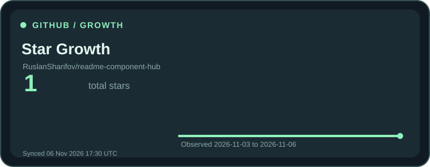 |
| CI/CD Status Card | Dynamic SVG | 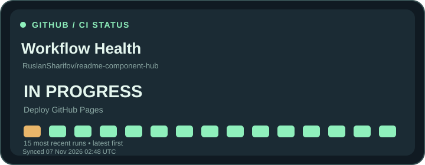 |
| Contribution Heatmap | Dynamic SVG | 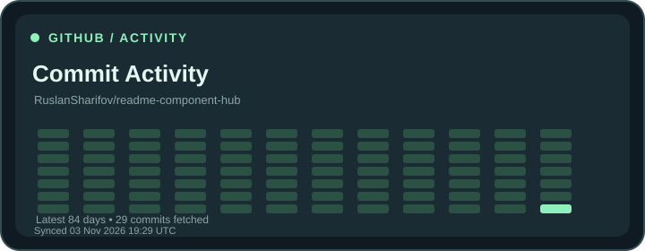 |
| Tech Language Analytics | Dynamic SVG | 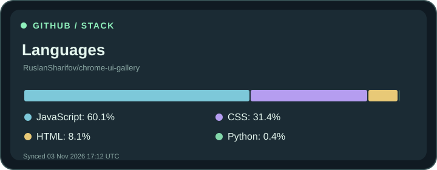 |
| Latest Release Card | Dynamic SVG | 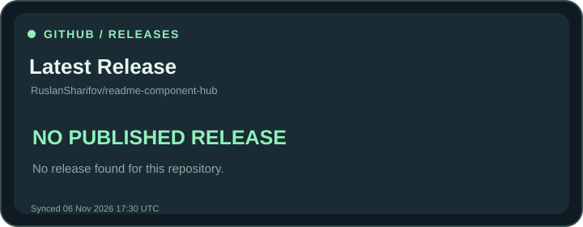 |
| Project Progress Tracker | Dynamic SVG | 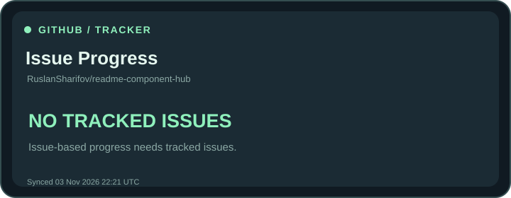 |
| Terminal Typing Banner | Animated GIF | 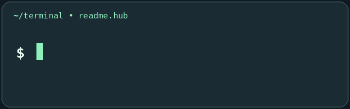 |
| Developer Identity Card | Static SVG | 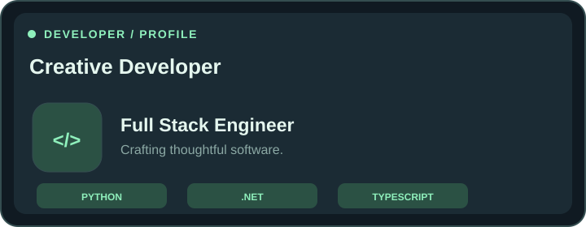 |
| Premium Dividers Pack | Static SVG | 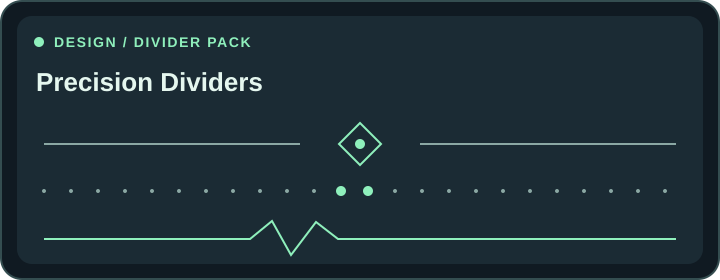 |
| Animated Workflow Diagram | Animated GIF | 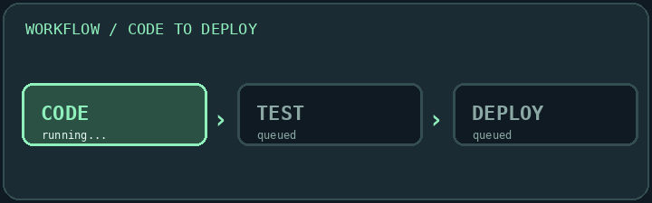 |

Every component includes dark, light and neon variants where applicable. Image width can be set to 30%, 50%, 70% or 100%, with left, centre or right alignment and an approximate left offset of 0–40%.

**Example: two cards side by side**

```html
<table width="100%">
  <tr>
    <td width="50%" align="center"></td>
    <td width="50%" align="center">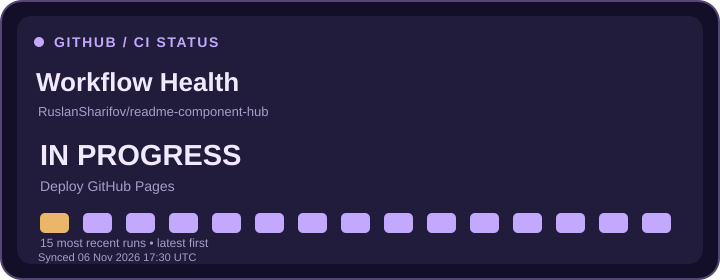</td>
  </tr>
</table>
```

---

## Dynamic GitHub cards

The **Repository Stats Card** fetches public data through GitHub Actions and publishes a standalone SVG. It shows **stars, forks, open issues, latest push date and refresh time**.

<div align="center">
  
</div>

```md

```

> [!NOTE]
> GitHub's open issue count also includes pull requests. Cards refresh **about once per hour** through a scheduled workflow, so they do not update instantly when stars change.

### Chrome UI Gallery stats

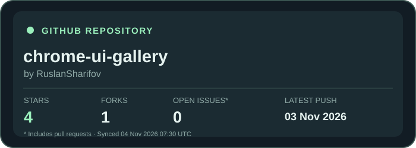

```md

```

### Choosing a repository

Each dynamic SVG is bound to one GitHub repository and **cannot detect which README embeds it**. Select the repository in the gallery; the generated Markdown then points to that repository's own card. To track a different repository, add a component manifest with `"renderer": "github-repo"` and `"repository": "OWNER/REPO"`, then open a pull request. See [CONTRIBUTING.md](CONTRIBUTING.md).

---

## README Designer

The **[README Designer](https://ruslansharifov.github.io/readme-component-hub/designer.html)** is a visual editor for complete README files. Combine Markdown text, headings, lists, code blocks and component cards. Drag components into place, build two- or three-column rows, then export an ordinary `README.md`.

### Bind the Designer to any public repository

Paste a public URL, such as `https://github.com/RuslanSharifov/chrome-ui-gallery`, into **Target repository**. Leaving the field empty uses [readme-component-hub](https://github.com/RuslanSharifov/readme-component-hub).

- The repository controls the **whole document**. Changing it rewrites every managed component block, while Markdown you wrote by hand stays unchanged.
- Live previews load public statistics through the GitHub API in the browser.
- Static images remain hosted by this project. Dynamic SVGs link to the selected repository's own generated assets.
- Generated SVGs are published to a dedicated `readme-component-hub-assets` branch, which works even when `main` is protected.

### One-time setup for dynamic cards in another repository

GitHub Pages cannot write files into other repositories, so the target repository needs a small workflow. The Designer provides **Copy workflow YAML** and **Download workflow** buttons. Create `.github/workflows/readme-component-hub.yml` on the default branch:

```yaml
name: Update README Component Hub cards
on:
  workflow_dispatch:
  schedule:
    - cron: '23 * * * *'
permissions:
  contents: write
jobs:
  update:
    uses: RuslanSharifov/readme-component-hub/.github/workflows/render-repository.yml@main
    permissions:
      contents: write
```

Commit the file, then run **Actions → Update README Component Hub cards → Run workflow** once. If the run fails with a permissions error, enable read and write access under **Settings → Actions → General → Workflow permissions**. After the first successful run, cards are written to `.github/readme-component-hub/<component-id>/<theme>.svg` on the assets branch and refresh hourly.

Example for Chrome UI Gallery after installation:

```md

```

> [!WARNING]
> The reusable workflow runs public code from this repository's `main` branch with `contents: write` access. Review it first. For stricter reproducibility, pin the reference to an audited commit SHA instead of `@main`.

### Limitations to know

- GitHub README images cannot run scripts or call APIs. Charts are pre-rendered, so they can lag by up to an hour.
- Star history begins at the first recorded snapshot. Earlier growth is not estimated.
- The heatmap reflects commit history, and the progress card uses issue state rather than a calculated completion score.
- If a repository has no published release, the release card says so.
- GitHub may strip inline CSS. Width and table-based offsets are best-effort and can differ on phones.
- The live editor is a GitHub-**style** preview, not GitHub's server renderer.

---

## Add your own component

Contributions are welcome. Submit an original SVG or GIF component through a pull request, with no separate account or service.

1. **Fork** the repository and create a branch.
2. Add a folder at `components/your-component-name/`.
3. Include a `component.json` manifest, a `README.md` and both dark and light images.
4. Follow the safety and naming rules in [CONTRIBUTING.md](CONTRIBUTING.md).
5. Open a **pull request**. After review, GitHub Actions rebuilds the gallery.

A manifest looks like this:

```json
{
  "id": "minimal-divider",
  "title": "Minimal Divider",
  "description": "A precise, understated line to separate your README sections.",
  "category": "Dividers",
  "tags": ["line", "divider", "minimal"],
  "author": "RuslanSharifov",
  "format": "svg",
  "featured": true,
  "order": 5,
  "addedAt": "2026-11-03",
  "themes": {
    "dark": "components/minimal-divider/dark.svg",
    "light": "components/minimal-divider/light.svg"
  }
}
```

For animated GIF submissions, see [CONTRIBUTING.md](CONTRIBUTING.md). The gallery accepts files and metadata only. It never executes contributor code.

---

## How it works

| Part | Technology |
|---|---|
| Website | HTML, CSS and vanilla JavaScript |
| Hosting | GitHub Pages |
| Catalog | One JSON manifest per component, compiled by `scripts/build_catalog.py` |
| Artwork | SVG, animated GIF and periodically refreshed repository statistics |
| Automation | GitHub Actions for validation, rendering and deployment |
| Contributions | GitHub pull requests |
| Backend or database | None required |

The deployment workflow regenerates animated GIFs and dynamic cards, runs the tests and publishes the site. Both themes are served as normal files, so the website previews the same images that appear in your README.

### Run and deploy locally

**Requirements:** Python 3.10+ and Pillow for GIF rendering. No separate JavaScript build step is needed.

```bash
git clone https://github.com/RuslanSharifov/readme-component-hub.git
cd readme-component-hub
python3 -m pip install -r requirements-assets.txt
python3 scripts/build_catalog.py
python3 scripts/render_gifs.py
python3 -m http.server 8000
```

Open <http://localhost:8000> in your browser.

To publish your own copy, go to **Settings → Pages → Build and deployment** and select **GitHub Actions**. The [deployment workflow](.github/workflows/deploy.yml) publishes the site on every push to `main`.

**Live website:** https://ruslansharifov.github.io/readme-component-hub/

---

## License

Released under the [MIT License](LICENSE).

<div align="center">

### Made for the GitHub developer community

**[Explore components](https://ruslansharifov.github.io/readme-component-hub/)** · **[README Designer](https://ruslansharifov.github.io/readme-component-hub/designer.html)** · **[Contribute](CONTRIBUTING.md)** · **[Report an issue](https://github.com/RuslanSharifov/readme-component-hub/issues)**

Maintained by [@RuslanSharifov](https://github.com/RuslanSharifov)

<br />


</div>
