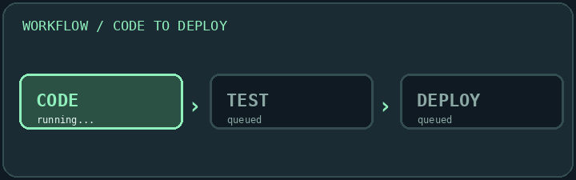

# Animated Workflow Diagram

Animated CI workflow progression from code to testing and deployment.

- Type: Animations (GIF)
- Themes: dark, light, neon

**Preview and copy Markdown:** [README Designer](https://ruslansharifov.github.io/readme-component-hub/designer.html)

```md

```

All rendered assets are published in the repository by GitHub Actions. Width, alignment, offset and side-by-side layout are controlled by the generated README HTML, not CSS parameters on the raw image URL.
