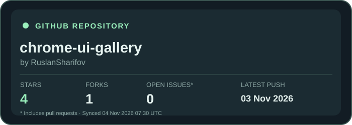

# Chrome UI Gallery Stats

This card tracks the **RuslanSharifov/chrome-ui-gallery** repository, NOT the README Component Hub repository.

It is refreshed with GitHub API values by the hourly GitHub Actions workflow, producing README-compatible dark and light SVG files.

## GitHub README embed

```md

```

The last-push date is the repository `pushed_at` timestamp, not the README viewer's access time. A static image cannot automatically detect which repository embeds it. Each tracked repository needs its own registered component.
