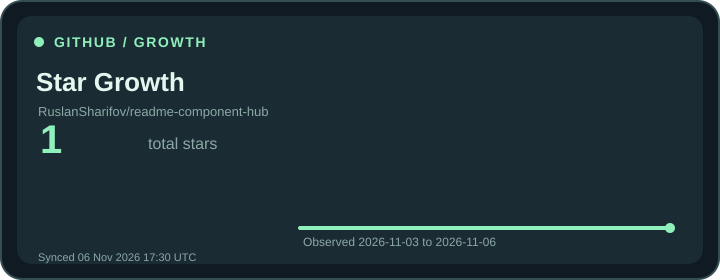

# Star Growth Chart

An honest tracked star history graph that builds up from scheduled GitHub snapshots.

- Type: Dynamic (SVG)
- Themes: dark, light, neon
- Tracked repository: `RuslanSharifov/chrome-ui-gallery` (updated through scheduled GitHub Actions; not live per request)

**Preview and copy Markdown:** [README Designer](https://ruslansharifov.github.io/readme-component-hub/designer.html)

```md

```

All rendered assets are published in the repository by GitHub Actions. Width, alignment, offset and side-by-side layout are controlled by the generated README HTML, not CSS parameters on the raw image URL.
